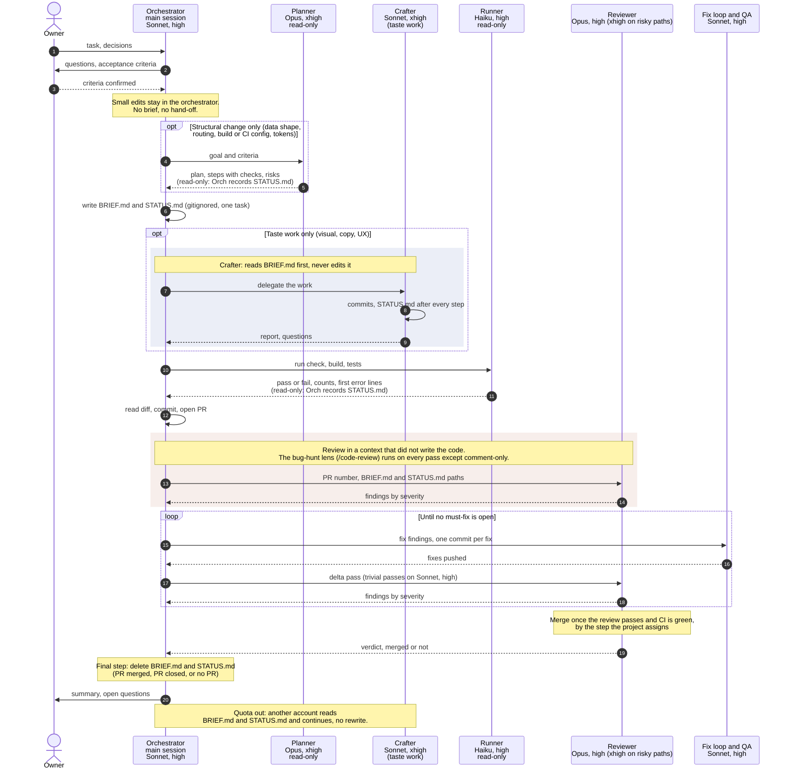

# Agent routing kit

A small, project-agnostic template for routing work across Claude models. A Claude Code
session in any project reads it and adapts it into that project's own `.claude/` setup.

The kit gives you:

- A role table (in `ROUTING.md`): which model and effort handles which kind of work.
- Agent templates (planner, crafter, reviewer, runner) with the model and effort pinned.
- A hand-off protocol (`BRIEF.md` and `STATUS.md`) so a quota limit or an account switch loses
  nothing.
- Instructions written for an agent that adapts all of this to a new project.

Work is routed by what it is, never by a guess at how hard it is. The role table, the rules and
the working model (one session, one task) are in `ROUTING.md`.

## Adopt it in a new project

Start a new session in the project and send:

```text
Read /Users/viacheslav/projects/personal/agent-routing/ADOPT.md and adapt the routing to this project
```

The agent inspects the project, shows an adapted table, and waits for your confirmation before it
writes anything. It never changes your global settings.

## Flow



## Files

| Path                               | Purpose                                                           |
| ---------------------------------- | ----------------------------------------------------------------- |
| `ADOPT.md`                         | Steps for an agent adapting the kit to a project                  |
| `ROUTING.md`                       | Principles, role table, rules, hand-off files                     |
| `templates/settings.json`          | Project `model` and `effortLevel`                                 |
| `templates/BRIEF.md`               | Skeleton the orchestrator fills once per task, then deletes       |
| `templates/STATUS.md`              | Skeleton updated after every step, then deleted with the brief    |
| `templates/agents/*.md`            | Planner, crafter, reviewer and runner with placeholders           |
| `GITHUB-SETTINGS.md`               | GitHub repository standard (merging, protection, Actions, labels) |
| `scripts/apply-github-standard.sh` | Applies that standard to one repository                           |

## Worked example

A project-specific instance of this kit lives in `/Users/viacheslav/projects/personal/vdanilov`
(a Next.js portfolio site):

- `.agents/skills/shared/site-conventions.md`, sections "Model routing" and "Brief and status"
- `.agents/agents/site-planner.md`, `site-crafter.md`, `site-reviewer.md`, `site-runner.md`
- `.claude/settings.json`

`.claude/skills` and `.claude/agents` are symlinks into `.agents/`.

## Keeping the kit and the copies in sync

- The kit is the template. Each project owns its adapted copy and may change it freely.
- A project never reads the kit at run time. The copy must stand alone.
- When you find an improvement in a project, bring it back here by hand. Strip the project's names
  and paths first, then update the templates and `ROUTING.md`.
- When the kit improves, existing projects do not change on their own. Ask a session to compare the
  project copy with the kit and propose the differences.
