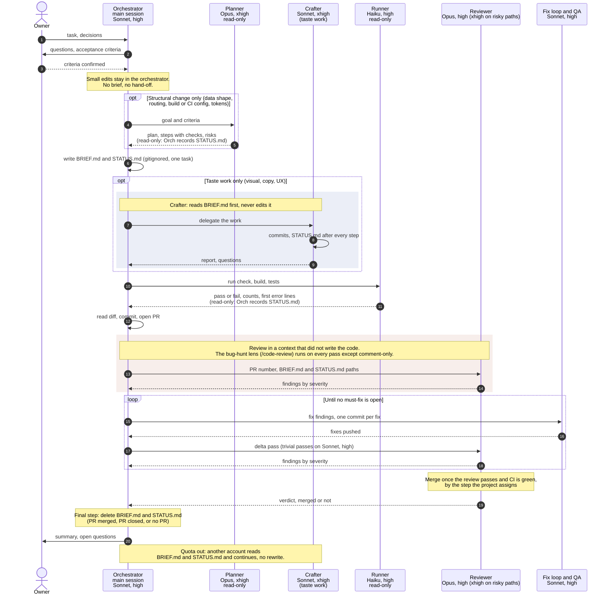
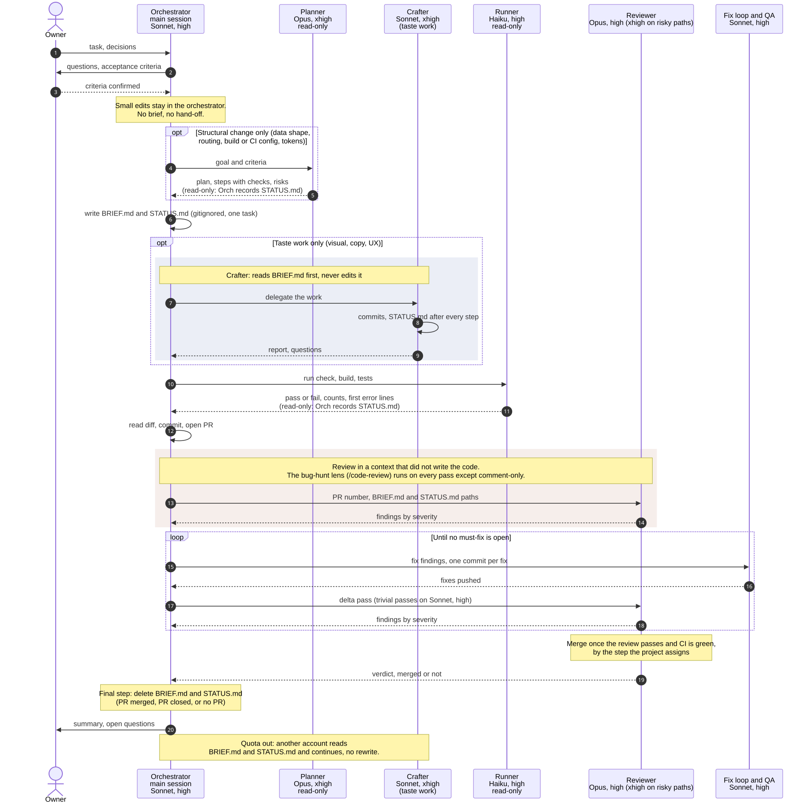

# Agent routing kit

A small, project-agnostic template for routing work across Claude models. A Claude Code
session in any project reads it and adapts it into that project's own `.claude/` setup.

The kit gives you:

- A role table: which model and effort handles which kind of work.
- Agent templates (planner, crafter, reviewer, runner) with the model and effort pinned.
- A hand-off protocol (`BRIEF.md` and `STATUS.md`) so a quota limit or an account switch loses
  nothing.
- Instructions written for an agent that adapts all of this to a new project.

Work is routed by what it is, never by a guess at how hard it is. See `ROUTING.md`.

Working model: one session, one task, one working copy. Task sessions start on Sonnet at `high`.
Process or architecture talks start on Opus and stay short. Implementation after them goes to a
new Sonnet session, not a model switch. Details are in `ROUTING.md`.

## Adopt it in a new project

Start a new session in the project and send:

```text
Read /Users/viacheslav/projects/personal/agent-routing/ADOPT.md and adapt the routing to this project
```

The agent inspects the project, shows an adapted table, and waits for your confirmation before it
writes anything. It never changes your global settings.

## Flow





## Routing table

| Work                                                                                      | Worker                                            | Model, effort  |
| ----------------------------------------------------------------------------------------- | ------------------------------------------------- | -------------- |
| Dialog, criteria, brief, status, small edits, commits                                     | the main session (orchestrator)                   | Sonnet, high   |
| A plan for a structural change: data shape, routing, build or CI config, design tokens    | `planner` agent, read-only                        | Opus, xhigh    |
| Work that depends on taste: visual, copy, UX                                              | `crafter` agent                                   | Sonnet, xhigh  |
| Code with no taste in it: tests, data, scripts, accessibility, performance, an exact plan | the main session (orchestrator)                   | Sonnet, high   |
| Review, first pass or delta                                                               | `reviewer` agent                                  | Opus, high     |
| Review when the change touches a high-risk path                                           | `reviewer` agent, `effort: xhigh`                 | Opus, xhigh    |
| Review, trivial re-pass or comment-only pass                                              | general-purpose agent, `model: sonnet`            | Sonnet, high   |
| Fix loop and QA after review                                                              | general-purpose agent, `model: sonnet`            | Sonnet, high   |
| Review lens: bug hunt (`/code-review`), every pass but comment-only                       | general-purpose agent, `model: sonnet`, read-only | Sonnet, xhigh  |
| Objective audits: accessibility, performance, security scans                              | general-purpose agent, `model: sonnet`, read-only | Sonnet, high   |
| Merge, once the review passes and CI is green                                             | the step the project assigns                      | the step's own |
| Run check, build and test commands; search; count; summarise long output                  | `runner` agent, read-only                         | Haiku, high    |

## Files

| Path                            | Purpose                                                        |
| ------------------------------- | -------------------------------------------------------------- |
| `ADOPT.md`                      | Steps for an agent adapting the kit to a project               |
| `ROUTING.md`                    | Principles, role table, rules, hand-off files                  |
| `templates/settings.json`       | Project `model` and `effortLevel`                              |
| `templates/BRIEF.md`            | Skeleton the orchestrator fills once per task, then deletes    |
| `templates/STATUS.md`           | Skeleton updated after every step, then deleted with the brief |
| `templates/agents/*.md`         | Planner, crafter, reviewer and runner with placeholders        |
| `diagram/routing.{mmd,svg,png}` | The flow diagram, source and renders                           |

## Worked example

A project-specific instance of this kit lives in `/Users/viacheslav/projects/personal/vdanilov`
(a Next.js portfolio site):

- `.claude/skills/shared/site-conventions.md`, sections "Model routing" and "Brief and status"
- `.claude/agents/site-planner.md`, `site-crafter.md`, `site-reviewer.md`, `site-runner.md`
- `.claude/settings.json`

## Keeping the kit and the copies in sync

- The kit is the template. Each project owns its adapted copy and may change it freely.
- A project never reads the kit at run time. The copy must stand alone.
- When you find an improvement in a project, bring it back here by hand. Strip the project's names
  and paths first, then update the templates and `ROUTING.md`.
- When the kit improves, existing projects do not change on their own. Ask a session to compare the
  project copy with the kit and propose the differences.

## GitHub settings

- [`GITHUB-SETTINGS.md`](GITHUB-SETTINGS.md): the GitHub repository standard (merging, protection, Actions, labels) and `scripts/apply-github-standard.sh`, which applies it to a repository
